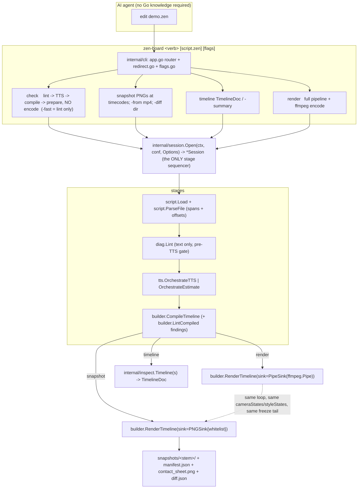
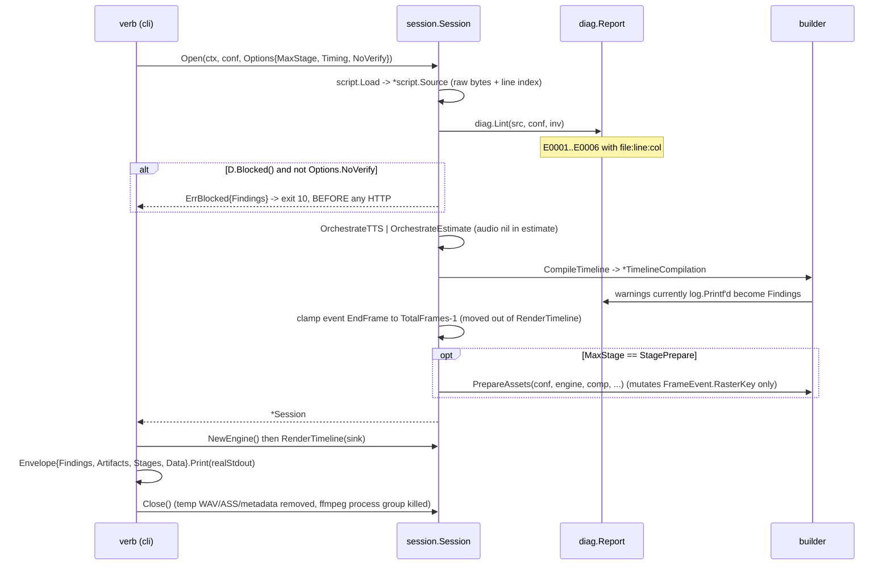

# ARCHITECTURE PLAN — Agent Verify Loop (`check` · `snapshot` · `timeline`)

**Slug:** `agent-verify-loop` · **Date:** 2026-10-23 · **Owner:** zen-board
**Inputs:** `RESEARCH_hyperframes_improvements.md` §3.1/3.2/3.3/3.6/3.8, `STUDY_COMPETITOR_script-whiteboard-video.md` §4 #1–#2, Draft v2 + red-team response (`/tmp/zen-mcp/chat/chat-1792749066885.md`).

---

## 1. Summary

zen-board already has the thing HyperFrames had to engineer into a Chromium stack: a deterministic, pure-function, single-binary render core (`render.Engine.RenderFrame(frameNum, events, cam, style)`) with an audio-first timing model. What it lacks is the loop *around* that core, so an AI agent today must pay for a full encode to discover that `[drw:robot]` was a typo — and even then the only feedback is a video it cannot cheaply look at. This plan adds exactly three agent-facing capabilities and the one structural change they share: **`check`** validates a `.zen` script *before* any TTS is spent and reports findings with `file:line:col`; **`snapshot`** writes PNGs of the exact frames an encode would write, at any timecode, with no ffmpeg and no encode; **`timeline`** dumps the compiled timeline as data with the `.zen` source line attached to every event. All three run on a single staged orchestrator (`internal/session`) and emit one machine-readable JSON envelope, so `edit → check → snapshot → read image → edit` costs seconds and zero render minutes. Deliberately excluded: the audio pass, variables/batch, `[include:]` scenes, Studio GUI, render profiles, history — none of them are on the path from "script in hand" to "know what the screen looks like at 12.4 s".

Two live defects found while planning (both `[VERIFIED]` by execution against the current parser) are prerequisites, not extras, because `lint` cannot run on top of them:

1. `script.Parse` **panics** (`slice bounds out of range [23:15]`) on nested tags such as `[text:"a [draw:x] b"]` — `extractActions` slices `line[lastPos:t.start]` when a later-sorted tag starts before the previous tag ended (`internal/script/parser.go:207-209`).
2. `[draw:robot:2.5]` — the reveal-duration form documented in `API_zen-board-script-and-config.md` — **matches no regex** (`[:\w-]+` has no `.`), producing 0 actions and speaking the literal tag aloud.

---

## 2. Interview outcomes (binding decisions)

| # | Question | Decision |
|---|---|---|
| Q1 | Timing source for inspection | `-timing cache\|estimate`; estimate is opt-in, always labelled `_est`, never a silent fallback |
| Q2 | Which frame to read | both engine-side PNGs and MP4-extracted PNGs, same `Artifact` type, `Kind` field distinguishes |
| Q3 | Lint scope | error-tier only (6 codes) + pre-TTS gate; post-compile tier deferred, existing `log.Printf("Warning: …")` sites become findings now |
| Q4 | CLI shape | verbs + deprecated flag-only alias; `-json` global; Envelope alone on stdout |
| Q5 | Caches | paint cache + SVG raster disk cache; hardcoded `http://localhost:8765` → `Project.LightsAddr` (zen-lights is **local-only**, same filesystem — confirmed by user) |
| Q6 | Snapshot output | per-frame PNGs + auto contact sheet ≤ 16 cells; selectors `-at/-every/-events/-chapters/-frame`; cap `-max 24` |
| Q7 | Verb set | **exactly four**: `render`, `check`, `snapshot`, `timeline`. No `doctor`, no `explain`, no `lint`/`info`/`frames`/`compare`/`stats` verbs |
| Q8 | Diff + timings | `snapshot -diff <dir>` → `diff.json` + heatmaps; stage timings always reported |
| Q9 | Sequencing | shell-first, one build, report at 4 checkpoints |
| Q10 | Snapshot frame provenance | **through the existing `RenderTimeline` loop via a `FrameSink` + frame whitelist** — parity by construction, no `BuildFrameStates` extraction |
| Q11 | Paint cache format | local-filesystem fetch (`os.Open`) → copy bytes to cache root; key excludes `lightsAddr` |

---

## 3. System boundaries



**Boundary rules**

* `internal/diag`, `internal/envelope`, `internal/ui-adjacent` code are **leaf packages**; `builder` may import `diag`, never `cli`. The red-team caught a real cycle in Draft v2 (`cli → diag → builder → cli`, created by `builder` taking a `*cli.UI`); it is removed by deleting the UI-writer dependency entirely (§6, step 1).
* No new subprocess surface except `ffmpeg` for `snapshot -from` (read-only decode) — no ffplay, no encoding.
* `render.Engine` is one-shot: `RenderTimeline` closes `engine.Pool.Jobs`. Therefore **one `Engine` per verb invocation**, produced by `Session.NewEngine()`; a `Session` never serves both `render` and `snapshot`.

---

## 4. Data flow and state management

### 4.1 Stage state and ownership



### 4.2 Mutation inventory (the part that must be respected)

| State | Owner | Mutated by | Consequence if reused |
|---|---|---|---|
| `Timeline.Events[i].TargetImage` | `CompileTimeline` | today `PrepareAssets` rewrites it to the SVG raster key (`timeline.go:471`) — **this is why a second `PrepareAssets` silently registers nothing** | **Fixed by this plan:** rewrite moves to a new `FrameEvent.RasterKey`; `TargetImage` stays canonical forever (asset id), so reports, lint and a second prepare all agree |
| `Engine.Assets` / `Engine.ScaledAssets` | `PrepareAssets` + lazily inside `RenderFrame` (`engine.go:270,315,527,653`) under `AssetMu` | per-`Engine` | values are deterministic functions of the key, so concurrent duplicate computation is benign; buffers must never cross Engines |
| `Pool.BufferPool` (`*sync.Pool`) | `Engine` | `RenderFrame` Get, sink/consumer Put | a sink that retains a frame **must copy**; `PNGSink` encodes then `Put`s (§7 C4) |
| temp WAV / ASS / FFMETADATA files | today `main.go` `defer os.Remove` | moves to `Session.Close()`; if `snapshot` exits early they leak | `Session.Close()` is `defer`red by every verb |
| `snapshots/<stem>/` | `snapshot` | stale PNGs from an older script look current | `manifest.json` carries the script hash + this run's file list; the dir is wiped when the hash differs |

### 4.3 Determinism contract (written down + tested, not assumed)

* Frame time is `frameNum / fps` — integer frame index, never a clock.
* No `math/rand` anywhere in `internal/render/**` (verified true today; enforced by `TestNoNondeterministicImports`).
* `time.Now` in `internal/render/**` is permitted **only** at the `RenderStats` accumulation sites in `engine.go` (they never touch pixels); the grep test allowlists `engine.go` only.
* All assets resolve before frame 0 (`PrepareAssets`), which `Session` guarantees by ordering.
* The hand "breathing jitter" is `3.0 * sin(2π·frame/60)` (`hand.go:133`) — a pure function of frame index. **No `Project.Seed` is added**: there is no randomness source, and dead config is debt.

---

## 5. CLI contract

### 5.1 Verbs

```
zen-board render   [script.zen] [flags]   # today's pipeline, unchanged behaviour
zen-board check    [script.zen] [flags]   # gate + cost report; -fast = parse+lint only, no network
zen-board snapshot [script.zen] [flags]   # PNGs without ffmpeg
zen-board timeline [script.zen] [flags]   # machine-readable timeline
zen-board assets   <subcommand>           # unchanged (internal/assets/cli.go:9)
zen-board -script x.zen                   # DEPRECATED alias for render; one stderr warning line
```

### 5.2 Flag matrix (exact; `-json`, `-timing`, `-max` etc. are per-verb, not global)

| Flag | render | check | snapshot | timeline | Notes |
|---|:-:|:-:|:-:|:-:|---|
| `-script` (or positional) | ● | ● | ● | ● | positional wins |
| `-config` | ● | ● | ● | ● | today: binary dir then cwd (`main.go:39-45`); explicit path overrides |
| `-json` | ● | ● | ● | ● | Envelope on real stdout, all human text to stderr |
| `-tts`, `-speed`, `-voice`, `-tts-cache`, `-lights-addr` | ● | ● | ● | ● | new `-lights-addr` (today only the assets CLI has it) |
| `-timing cache\|estimate` | (cache) | ● | ● | ● | render is always `cache`; passing `estimate` to render is a usage error (exit 2) |
| `-no-verify` | ● | ● | ● | — | bypass the lint gate |
| `-assets`, `-w`, `-h`, `-fps` | ● | ● | ● | ● | |
| `-o` | ● | — | ● (dir) | — | `-o` semantics differ per verb; documented in usage text |
| `-at`, `-every`, `-events`, `-chapters`, `-frame`, `-max`, `-max-w`, `-sheet`, `-cells`, `-cell-w`, `-from`, `-diff`, `-threshold` | — | — | ● | — | snapshot-only |
| `-summary`, `-words`, `-from-sec`, `-to-sec` | — | — | — | ● | timeline-only |
| `-preview`, `-fast`, `-freeze`, `-camera`, `-bgm`, `-bgm-vol`, `-cursor`, `-hand`, `-eventlog`, `-disable-transcript` | ● | — | — | — | render-only |
| `-fast` on check/snapshot | — | |error| |error| — | `-fast` halves `conf.Width/Height` **before** compile (`main.go:98-106`); since `@x,y,w,h` are absolute pixels it already misplaces explicitly-positioned elements, so inspection verbs must refuse it rather than inherit it |

### 5.3 Envelope schema (`internal/envelope`)

```
Envelope {
  ok          bool
  command     string                 // "snapshot"
  version     string                 // build-ldflags injected; else "dev"
  script_hash string                 // sha256(script || resolved-config || voice || timing)
  findings    []diag.Finding         // always present (possibly [])
  artifacts   []envelope.Artifact    // {path, frame, time_sec, kind: engine|encode|sheet|diff|manifest, label}
  stages      envelope.Timings       // {lint,tts,compile,prepare,render,encode: seconds, tts_calls, tts_cache_hits, raster_cache_hits, paint_cache_hits, frames_rendered, total_frames, fps_achieved}
  data        any                    // verb payload: TimelineDoc | CheckSummary
  error       envelope.ErrorInfo?    // {code, message, hint, file?, line?, col?}
}
```

Exit codes: `0` ok · `1` generic error (unchanged from today, so existing callers keep working) · `2` usage/unknown flag · `3` environment (ffmpeg/ffprobe absent, TTS or lights unreachable, cache dir unwritable) · `4` internal/panic-recovered · **`10` blocked by lint errors** (kept off `1` deliberately — `main.go:63-66` today exits 1 for everything).

Environment diagnosis lives in `ErrorInfo.Hint`, not in a `doctor` verb (Q7). Every env-class failure is produced by a typed error so the hint is not guesswork:

```
// internal/envelope/errors.go
type EnvError struct{ Step, Detail, Hint string; Err error }   // -> exit 3
func (e *EnvError) Error() string; func (e *EnvError) Unwrap() error
type BlockedError struct{ Report diag.Report }                 // -> exit 10
type UsageError struct{ Msg string }                          // -> exit 2
func ExitCode(err error) int                                  // errors.As chain
```
Hints that must exist (they are the loop's guardrails): TTS unreachable → `"start zen-lights, or pass -timing estimate for approximate frames"`; ffmpeg absent (render only) → names `-preview` absence; paint path unreadable → `"zen-lights must run on this machine: /paint/generate returns a server-local path"`.

---

## 6. Implementation Blueprint (one row per file)

`Depends on` = step numbers from §8.

### Group A — source model, vocabulary, findings

| File | Action | Concrete shape (pseudocode) | Depends on | Acceptance ("done when") |
|---|---|---|---|---|
| `internal/script/source.go` | create | `type Source struct{ Path string; Raw []byte; Lines []Line }`; `type Line struct{ Number, Offset, Length int; Text string }` (`Number` 1-based, `Offset` = byte offset of the **first byte of the raw line including leading whitespace**) · `func Load(path string) (*Source, error)` · `func (s *Source) Locate(byteOffset int) (line, col int)` · `func (s *Source) Snippet(line, col, width int) (text string, carets string)` · `func (s *Source) Hash() string` | — | `Locate` on a fixture with CRLF-free and non-ASCII lines returns the 1-based line/col that a text editor shows; `Parse("…")` (old entry point, `parser.go:33`) still compiles and `internal/script/parser_test.go` passes untouched |
| `internal/script/parser.go` | modify | keep `Parse`; add `func ParseFile(s *Source) []model.ScriptLine`; `extractActions` returns spans and **rejects overlapping tag spans** (sort by start, require `t.start >= lastPos`, else emit `spanConflict` diagnostic instead of slicing); every produced `DrawAction` is filled with `SrcOffset/SrcLength/SrcLine/SrcCol/SrcRaw`; all line-relative offsets get `+line.Offset` **and** the trimmed-leading-whitespace delta (parser TrimSpaces at `parser.go:37`) | A1 | (a) the regression fixture `[text:"a [draw:x] b"]` no longer panics and reports a span conflict; (b) `examples/*.zen` produce byte-identical `[]ScriptLine{Text}` as before (behaviour-preserving apart from the panic fix); (c) a fixture with 12 tags over 4 lines yields exactly 12 actions with `SrcLine ∈ {1..4}` and `SrcRaw == source[SrcOffset:SrcOffset+SrcLength]` |
| `internal/script/tag.go` | create | `type ArgKind int // argAsset argPreset argCoords argDuration argColor argText argEnum` · `type DrawTag struct{ AssetID string; Preset string; Dims [4]int; HasDims bool; RevealDuration float64; HasReveal bool; Variants map[string]string; TriggerAfter bool; Unknown []string }` · `func ParseDrawTag(raw string) (DrawTag, error)` · `func SplitParts(s string) []string` (quote-aware, the logic today inlined at `parser.go:47-67`) | A1 | `ParseDrawTag` round-trips every tag in `examples/*.zen`; the split used by `builder.processAction` (`compile_actions.go:169-226`) and by lint is now literally the same function |
| `internal/script/dsl.go` | create | `type Status string // stable noop deprecated` · `type Param struct{ Name string; Kind ArgKind; Default string; Enum []string; Required bool }` · `type ActionSpec struct{ Name, Syntax string; Status Status; Params []Param; AssetArgs []string // which param slots hold asset refs; EmitsEvent string }` · `func All() []ActionSpec` · `func ByTag(tag string) (ActionSpec, bool)` · `func Patterns() []TagPattern // {Tag string; Re *regexp.Regexp; Extract Kind}` — **this table owns the regexes now living at `parser.go:11-31`** | A1 | `TestDSLCoverage`: every `constant.TAG_*` (`constant.go:9-33`) has a spec and a pattern; every `case` in `dispatch` (`compile_actions.go:44-93`) is reachable from a spec; `TestPatternTableMatchesLegacy` — table-driven extraction == today's 20 sequential regex calls on all `examples/*.zen` |
| `internal/model/layout.go` | modify | add `func LayoutPresets() []string` (the switch cases at `layout.go:6-27`, `reset`/`fullscreen`/`center` from `constant.go:80-82`) | A4 | unknown preset (`Tl`) is not in the returned list; the list is what `dsl.Presets()` returns (no duplicated literal) |
| `internal/model/types.go` | modify | `DrawAction` += `SrcOffset, SrcLength, SrcLine, SrcCol int; SrcRaw string` · `FrameEvent` += `AssetID string` (canonical, never rewritten) `, RasterKey string` (set only by `PrepareAssets`) `, SrcLine, SrcCol int` · `Project` += `LightsAddr string \`json:"lights_addr"\`` `, RasterCacheDir string \`json:"raster_cache_dir"\``, `PaintCacheDir string \`json:"paint_cache_dir"\`` and the json tags for the currently untagged fields | A1,A2 | `NewDefaultProject()` (`types.go:24-44`) fills `LightsAddr = constant.DEFAULT_LIGHTS_ADDR` (new const = `http://localhost:8765`, replacing the literal at `timeline.go:351`); a compiled `FrameEvent` from any example has `SrcLine != 0 && AssetID != ""` (`TestSrcLinePropagation`, §8 step 2) |
| `internal/diag/finding.go` | create | `type Severity string // error warning info` · `type Finding struct{ Code string; Severity Severity; Message, FixHint, File string; Line, Col int; Snippet string; Stage string }` · `type Report struct{ Findings []Finding }` with `func (r *Report) Add(Finding)`, `func (r *Report) Extend(Report)`, `func (r Report) Blocked() bool`, `func (r Report) ByCode(string) []Finding`, `func (r Report) Sorted() Report` · `func (f Finding) String() string` → `demo.zen:14:22: error[E0002]: …` + `  hint: …` | — | `Blocked()` true iff any `error`-severity finding; `go vet` clean on `Add`'s pointer receiver (Draft v2 had a value receiver that could never mutate) |
| `internal/diag/inventory.go` | create | `type Inventory struct{ Assets map[string]assets.AssetEntry; Resolved func(id string) (path string, ok bool); Presets, Styles, MaskStyles, HandStyles, Cursors map[string]bool; Canvas image.Rectangle }` · `func LoadInventory(conf *model.Project) (*Inventory, error)` | A4,A6 | cursors enumerated from `<assets_dir>/cursors/*.png` (the dir `main.go:205` already builds); `Resolved` is **the same function** `validateAssets` and `PrepareAssets` call — see A6b |
| `internal/assets/resolve.go` | create | `func Resolve(assetsDir string, idx *AssetIndex, id string) (path string, ok bool, fromIndex bool)` — the exact rule today duplicated at `timeline.go:243-252`, `timeline.go:270-277`, `timeline.go:397-408` | — | lint and compile agree on resolution: `TestResolveMatchesValidateAssets` fails an `.svg`-on-disk-but-not-in-index id identically in both paths |
| `internal/diag/lint.go` | create | `func Lint(src *script.Source, conf *model.Project, lines []model.ScriptLine, inv *Inventory) Report` — tokenizes from `src.Raw` (never from the already-cleaned `ScriptLine.Text`) and masks consumed spans | A1,A2,A4,A5,A6 | each rule has its own golden test in `lint_test.go`; all `examples/*.zen` lint to **zero `error` findings** |
| `internal/diag/rules.go` | create | error tier: `E0001 unknown_asset` (per-tag `AssetArgs` from the DSL table: draw, gen, slide, overlay, compare-left/right, erase, move) · `E0002 unknown_tag_spoken` (raw `[..]` span **not consumed** by any pattern **and** its prefix is within edit-distance 2 of a known tag; everything else → `W0002 literal_bracket_narrated`) · `E0003 malformed_tag` (span conflict, unclosed `[`, unknown prefix — one code per span, priority: span-conflict > unclosed > unknown-prefix) · `E0004 bad_coords` · `E0005 unknown_preset` · `E0006 unknown_keyword` (style/mask/hand/cursor) · `E0007 duration_unreachable` (a trailing `[:<num>.<num>]` that `drawRegex` cannot match — today's `[draw:robot:2.5]`) · info tier: `I0001 timing_estimated`, `I0002 snapshot_truncated`, `I0003 wordcount_mismatch` | A7 | the four verified live inputs behave as specced: `[drw:robot]`→`E0002` at the right col, `[draw:robot:2.5]`→`E0007`, `array[0]`→`W0002` (never an error, so it cannot block a render), `[text:"a [draw:x] b"]`→`E0003` not a panic |
| `internal/diag/compiled.go` | create | `func FromCompileWarnings(log []CompileWarning) Report` where `CompileWarning{Code, Msg string; Ev *model.FrameEvent}` — consumes what `builder` currently `log.Printf`s | A7,D4 | the `has_bg`, erase-of-unplaced, word-index-OOB and paint-failure paths each produce a `Finding` with a real `SrcLine` |

### Group B — CLI shell (ships first, behaviour-preserving)

| File | Action | Concrete shape | Depends on | Acceptance |
|---|---|---|---|---|
| `internal/envelope/envelope.go` | create | `Envelope`, `Artifact`, `Timings`, `ErrorInfo` exactly as §5.3; `func (e *Envelope) Print(w io.Writer) error` (one `Marshal` + one `\n`) | A6 | `json.Marshal` round-trip test; no `Data any` polymorphism leaks a `builder` type (payloads come from `inspect`/`snapshot`) |
| `internal/envelope/errors.go` | create | `EnvError`, `BlockedError`, `UsageError`, `func ExitCode(err error) int` | — | `ExitCode(nil)==0`; each sentinel maps to its code |
| `internal/cli/redirect.go` | create | `func RedirectForJSON() (realStdout *os.File, restore func())` → saves `os.Stdout`, sets `os.Stdout = os.Stderr`, `log.SetOutput(os.Stderr)`; returns a restore | — | with `-json`, a run whose stages call `fmt.Printf` still yields exactly one JSON document on the real stdout — **and zero exported signatures change** (this replaces Draft v2's 35-site `*cli.UI` refactor, which created the `cli→diag→builder→cli` cycle) |
| `internal/cli/flags.go` | create | `func commonFlags(fs *flag.FlagSet, conf *model.Project) *CommonOpts` + one `register<Verb>` per verb implementing the §5.2 matrix; `func (o *CommonOpts) Apply(conf *model.Project) error` | A6b | `-h` per verb lists only its own flags; `-fast` to `snapshot` returns `UsageError`; precedence flag > config > default asserted for `-lights-addr` |
| `internal/cli/app.go` | create | `type Context struct{ Conf *model.Project; Args []string; Opts *CommonOpts; Stdout io.Writer }` · `type Command struct{ Name, Summary, Usage string; Register func(*flag.FlagSet) *Options; Run func(*Context) (*envelope.Envelope, error) }` · `func New() *App` · `func (a *App) Run(args []string) int` | B1,B2,B3,B4 | `zen-board assets …` still dispatches to `assets.RunCLI` (`assets/cli.go:9`); unknown verb → exit 2 + verb list; `integration_test.go` (6 flag-only `os.Args` sites) passes **unmodified** |
| `internal/cli/render_cmd.go` | create | `Run` = today's `main.Run` body, moved | B1-B4,C1,C2 | `go build && ./zen-board -script examples/demo.zen` still writes `output.mp4` (the deprecated alias path) |
| `internal/cli/check_cmd.go` | create | `-fast` (parse+lint only), `-json` default off | C1,A7,A9 | `check` on a script with an unknown asset exits 10 having made **0 HTTP requests** (asserted via `internal/testutil` request counter) |
| `internal/cli/timeline_cmd.go` | create | `-summary`, `-words`, `-from-sec`, `-to-sec` | C1,D5 | see D5 |
| `internal/cli/snapshot_cmd.go` | create | the snapshot half of the §5.2 matrix | C1,F1-F4 | see F1-F4 |
| `main.go` | modify | keep `getBinaryDir`, `loadConfig` (+ `-config`), `Run()` = `os.Exit(cli.New().Run(os.Args[1:]))`; pipeline body deleted | B1-B5,C1 | `main.go` < 90 LOC; `go vet ./...` clean |

### Group C — the single staged pipeline

| File | Action | Concrete shape | Depends on | Acceptance |
|---|---|---|---|---|
| `internal/session/session.go` | create | `type Stage string // StageLint StageTTS StageCompile StagePrepare` · `type Options struct{ MaxStage Stage; Timing string; NoVerify, AllowPaintGen bool; UI *ui.Nothing /* none: see B1 */ }` · `type Session struct{ Conf *model.Project; Source *script.Source; Lines []model.ScriptLine; Words []model.WordTiming; PLines []model.ProcessedLine; Duration float64; AudioWAV []byte; Comp *builder.TimelineCompilation; Findings diag.Report; Stages envelope.Timings; TotalFrames int; prepared bool; tmp []string }` · `func Open(ctx context.Context, conf *model.Project, opts Options) (*Session, error)` · `func (s *Session) Close() error` · `func (s *Session) NewEngine() (*render.Engine, error)` · `func (s *Session) FrameAt(sec float64) (int, error)` · `func (s *Session) TimeOf(frame int) float64` · `func (s *Session) RenderInputs() (audioPath, assPath, metadataPath string, err error)` · `func (s *Session) ExtendedDuration() float64` | A2,A9,B*,D4 | `Open` is the only sequencer (replaces `main.go:120-238` including the ASS/`FFMETADATA1`/`extendedDuration` blocks at `main.go:158-203`); `FrameAt` returns an error when `TotalFrames<=0`, else `int(floor(sec*fps + 1e-9))` clamped (verified: `0.7*30 == 20.999999999999996`); a second `Open` on the same Session is impossible by construction (Session is unexported-state, `prepared` guard on `Prepare`) |
| `internal/session/session.go` (ctx) | note | thread `ctx` into HTTP: `tts.Client.Do` via `http.NewRequestWithContext`, and `GeneratePaintAsset` likewise (today bare `http.Post`, `client.go:36`, `timeline.go:351`) | C1 | `context.WithTimeout` + `signal.NotifyContext` in `cli` cancels a hanging TTS call; `Session.Close` kills the ffmpeg **process group** (`syscall.Kill(-cmd.Process.Pid, SIGKILL)` in `ffmpeg`) |
| `internal/tts/timing.go` | modify | add `func EstimateLineDuration(text string, speed float64) float64` = `totalVowelGroups / (constant.VOWEL_GROUPS_PER_SEC * speed)`, using the **existing** `countSyllables` (`timing.go:6`) so the estimator and the distributor agree | — | measured 2026-10-23 against the configured `en_US-ryan-medium` @ 1.0 over 12 lines of `examples/*.zen`: aggregate **5.3 groups/sec**, per-line spread 3.5–7.9 → `constant.VOWEL_GROUPS_PER_SEC = 5.3`; `TestEstimateCalibration` recomputes the aggregate from `*.wav`+`*.json` pairs in the TTS cache when present and fails if it drifts > 15 % |
| `internal/tts/orchestrator.go` | modify | add `func OrchestrateEstimate(lines []model.ScriptLine, speed float64) ([]model.WordTiming, []model.ProcessedLine, float64, error)` — no HTTP, no WAV; mirrors the `[wait:]`-only-line handling of `orchestrator.go:104-125` | C2 | `Session.Duration` in estimate mode == `sum(ProcessedLine.Duration)` (asserted); `OrchestrateTTS`'s exported signature unchanged |
| `internal/builder/sink.go` | create | `type FrameSink interface{ Wants(frame int) bool; WriteFrame(frame *image.RGBA) error; Close() error }` · `type PipeSink struct{ P *ffmpeg.Pipe; Owned *sync.Pool /* optional */ }` with `Wants() → true` · `func NewPipeSink(p *ffmpeg.Pipe) *PipeSink` · `type Whitelist struct{ Set map[int]bool }` with `func (w Whitelist) Wants(f int) bool` | — | `*PipeSink` satisfies `FrameSink` (compile-time `var _ FrameSink = (*PipeSink)(nil)`); `ffmpeg.Pipe.WriteFrame([]byte)` is kept untouched (`pipe.go:128`) and `PipeSink.WriteFrame` forwards `frame.Pix` |
| `internal/builder/renderer.go` | modify | `func RenderTimeline(ui *..., conf, timeline, engine, sink FrameSink, styleKeyframes, pLines, cameraEnabled, eventLog) error` — **the only changes**: (1) `pipe *ffmpeg.Pipe` → `sink FrameSink`; (2) in the job-feed loop (`renderer.go:117-139`) `if !sink.Wants(f) { continue }` before acquiring `sem`/submitting; (3) in the result loop (`renderer.go:150-176`) `if !sink.Wants(res.Index) { pool.Put; <-sem; continue }`; (4) `pipe.Close()` → `sink.Close()`; (5) the `EndFrame >= totalFrames` clamp moves to `Open`; (6) the duplicated 1 s camera transition constant (`renderer.go:66` and `timeline.go:122`) becomes `builder.ZoomTransitionSeconds`. Camera/style arrays **stay exactly where they are** | C1,D4 | `snapshot` and `render` call literally the same function; `go test ./internal/builder` green; frame-0/last-frame PNG for `examples/v3_test.zen` unchanged before vs after the diff (PSNR ≥ 45 dB, §8 step 5) |
| `internal/builder/timeline.go` | modify | (1) `GeneratePaintAsset(prompt, steps, w, h int, conf *model.Project)` — takes the address from config, no literal URL; (2) `PrepareAssets` gains `opts PrepareOptions{ PaintGen PaintFetcher; Report *diag.Report }` where `type PaintFetcher func(prompt string, w, h, steps int) (image.Image, error)` (nil ⇒ cache-only, miss ⇒ `E0001`-class finding, so `snapshot` never calls the diffusion model unexpectedly); (3) rewrite `ev.TargetImage = key` → `ev.RasterKey = key`; (4) all `log.Printf("Warning: …")` → `Report.Add` | A2,A9,D1,D2 | with `-timing estimate` no HTTP request is issued at all (`testutil` counter == 0); `render` still produces a byte-identical MP4 for `examples/short_test.zen` |
| `internal/render/engine.go` | modify | add `func (e *Engine) assetKey(ev model.FrameEvent) string` (`RasterKey` if set else `TargetImage`) and use it at the six lookup sites (`engine.go:253,259-260,303,471,518`); add the determinism contract comment above `RenderFrame` (`engine.go:129`) | D4 | `TestRenderFrameDeterministic` + `TestRenderFrameOrderIndependent` green; every `__text_`/`__banner_` prefix check (`engine.go:259,599`) still passes because those events never get a `RasterKey` |

### Group D — caches (kill the per-invocation cost)

| File | Action | Concrete shape | Depends on | Acceptance |
|---|---|---|---|---|
| `internal/builder/paintcache.go` | create | `func CachedPaintAsset(prompt string, w, h, steps int, conf *model.Project) (string, image.Image, error)`; key `sha256(prompt|w|h|steps)` (**not** `lightsAddr` — moving the server must not invalidate); path `<PaintCacheDir>/<key>.png`; miss → `os.Open(serverReturnedPath)` → `io.Copy` bytes into the cache (zen-lights is same-filesystem, confirmed) | C3 | running `check` twice on a `[gen:]` script issues **0** `/paint/generate` calls on the second run and `Stages.PaintCacheHits` reports the hit count |
| `internal/svg/diskcache.go` | create | `const RasterizerVersion = "zr1"` · `type header struct{ Magic [4]byte; W, H int32 }` · `func LoadRasterCache(dir, key string) (*image.RGBA, bool)` · `func SaveRasterCache(dir, key string, img *image.RGBA) error` — **raw `Pix` + bounds, not PNG** (a PNG round-trip converts premultiplied RGBA → non-premultiplied → premultiplied and loses low-alpha precision, which would silently break the determinism contract); write to `*.tmp` then `os.Rename` | — | `TestRasterCacheRoundTrip` asserts `bytes.Equal(got.Pix, want.Pix)` incl. a sprite with alpha < 32 |
| `internal/constant/constant.go` | modify | add `DEFAULT_LIGHTS_ADDR`, `VOWEL_GROUPS_PER_SEC`, `SNAPSHOT_MAX_DEFAULT = 24`, `SHEET_MAX_WIDTH = 1568`, `DIFF_MAD_THRESHOLD_DEFAULT = 2.0` (0–255 luma scale) | — | no hardcoded URL/rate literal remains outside `constant.go` |

### Group E — (removed) — see §9 "R1"

`internal/builder/states.go` and `BuildFrameStates` **do not exist in this plan.** Draft v2 proposed extracting the camera/style arrays out of `RenderTimeline` so `snapshot` could call `RenderFrame` directly; the red-team showed that this manufactures the very divergence risk it was meant to avoid, and Q10 chose the sink. The frame-whitelist sink gives parity *by construction*.

### Group F — inspection and capture

| File | Action | Concrete shape | Depends on | Acceptance |
|---|---|---|---|---|
| `internal/inspect/doc.go` | create | `const SchemaVersion = 1` · `type EventDoc struct{ Index int; Type, Asset string; StartFrame, EndFrame int; StartSec, EndSec float64; X,Y,W,H int; ZoomFocus, Style, MaskStyle, HandStyle, Cursor string; SrcLine, SrcCol int }` · `ChapterDoc{Index int; Title string; StartSec, EndSec float64}` · `AssetDoc{ID, File string; Exists, HasBg bool; UsedByFrames []int /* capped */}` · `WordDoc{Word string; StartSec, EndSec float64; Line int}` · `GapDoc{AfterSec, BeforeSec float64; Seconds float64; CausedBy *EventDoc /* the [wait:] or blank-line source */}` · `TimelineDoc{Schema int; Script, Timing string; Duration float64; FPS, Width, Height, TotalFrames int; Stages envelope.Timings; Chapters []ChapterDoc; Events []EventDoc; Gaps []GapDoc; Assets []AssetDoc; Words []WordDoc}` · `func Timeline(s *session.Session, withWords bool) TimelineDoc` · `func Summary(s *session.Session) map[string]any` (fixed key set, documented in the test) | C1,A2 | `timeline -json` for `examples/demo.zen`: every event's `srcLine` matches the line an editor shows; `Asset` shows `robot`, never an `e3b0c4_400_300` raster key; `Summary`'s per-type counts equal `engine.PrintStats`' event tally |
| `internal/snapshot/plan.go` | create | `type Request struct{ At []float64; Frames []int; Every time.Duration; Events string /* "",start,mid,end,all */; Chapters bool; Max, MaxWidth, Cells, CellW int; Sheet bool }` · `func Plan(fps, totalFrames int, events []model.FrameEvent, chapters []builder.ChapterMarker, r Request) (frames []int, dropped int, err error)` — **pure over plain data** (no `*Session`, so it is unit-testable without TTS); union of selectors → de-dup → sort → if `len > Max` keep first, then even-stride resample to `Max` and report `dropped` | C1 | `-every 0.5s` on a 1 h timeline produces ≤ `Max` frames and **renders nothing beyond them**; `dropped > 0` ⇒ `I0002 snapshot_truncated` listing the omitted times |
| `internal/snapshot/pngsink.go` | create | `type PNGSink struct{ Whitelist map[int]bool; Dir, ScriptStem string; MaxWidth int; S *session.Session; pngEncoder func(io.Writer, image.Image) error /* png.BestSpeed by default */ }` implementing `builder.FrameSink` (`Wants/WriteFrame/Close`) · `func (s *PNGSink) WriteFrame(frame *image.RGBA) error` → resolve `label` from the event list → optional downscale → `image/png` → `pool.Put(frame)` | C4,F1 | frame naming pinned in exactly one function: `fmt.Sprintf("f%06d_%07.2fs.png", frame, sec)` (+`_est` suffix when `Timing=="estimate"`); labels render `#idx • 12.40s • f000372 • draw:robot • zoom:BR • blackboard` using `render.RenderText` (`render/text.go`) |
| `internal/snapshot/snapshot.go` | create | `type Result struct{ Artifacts []envelope.Artifact; Manifest Manifest; Diffs []FrameDiff }` · `func Run(ctx context.Context, s *session.Session, r Request) (*Result, error)` (opens its own Engine via `s.NewEngine()`, calls `builder.RenderTimeline` with the `PNGSink`) | F1,F2,C4 | `snapshot -events examples/v3_test.zen` ≤ 24 PNGs + sheet in < 5 s at `-max-w 640` with warm caches, zero ffmpeg processes spawned |
| `internal/snapshot/manifest.go` | create | `type Manifest struct{ ScriptHash, Timing, Version string; Created time.Time; Frames []FrameRec }` · `func Write(dir string, m Manifest) error` · `func Load(dir string) (Manifest, bool)`; `Run` wipes the dir if `ScriptHash` differs | F3 | a stale PNG from a previous script version cannot be listed in `Envelope.Artifacts`, and cannot survive the next run |
| `internal/snapshot/mp4.go` | create | `func FromMP4(ctx context.Context, ffprobeBin, mp4Path string, frames []int, fps int, dir string) ([]envelope.Artifact, error)` — exact-frame decode `ffmpeg -i in.mp4 -vf "select=eq(n\,F)" -vsync 0 -frames:v 1 out.png`; probe with `ffprobe -show_entries stream=nb_frames` first and error (`EnvError` exit 3) if `nb_frames != totalFrames` | F1 | `Artifact.Kind == "encode"`; the frame count guard catches `-freeze`/`extendedDuration` mismatches instead of silently returning the wrong frame |
| `internal/snapshot/sheet.go` | create | `func WriteSheet(arts []envelope.Artifact, cellW, cols int, path string) error` — cols derived so total width ≤ `constant.SHEET_MAX_WIDTH` | F1 | 16-cell sheet ≤ 1568 px wide (fits a vision model's native tile without rescaling) |
| `internal/snapshot/diff.go` | create | `type FrameDiff struct{ Frame int; Baseline string; MADLuma float64 /* 0-255 */; MaxDelta int; Changed bool }` · `func Diff(curDir, baseDir string, frames []int, threshold float64) ([]FrameDiff, error)` · `func Heatmap(cur, base *image.RGBA, amp float64) *image.RGBA` · `func WriteJSON(path string, d []FrameDiff) error` · matching by **event-relative position** (`DiffMode = "frame" \| "event"`, default `event`: for each `EventDoc`, compare `StartFrame+k` to the baseline's same event's `StartFrame+k`; falls back to `frame` when event sets differ) · error on resolution mismatch | F1,F3 | same script vs itself ⇒ all `Changed=false`; changing one `[draw:]` preset's `@x,y` ⇒ `Changed=true` only over that event's frame range; `-diff` against a different-resolution baseline exits 2 with a hint |

### Group G — tests and docs

| File | Action | Shape | Acceptance |
|---|---|---|---|
| `internal/render/determinism_test.go` | create | `TestRenderFrameDeterministic`, `TestRenderFrameOrderIndependent`, `TestPooledBufferIsCleared`, `TestNoNondeterministicImports` (grep `internal/render/*.go` for `math/rand`; `time.Now` allowlisted to `engine.go` stats sites) | deterministic across two runs and shuffled order, including from a dirty pooled buffer |
| `internal/script/parser_test.go` | modify | add overlap/panic + offset fixtures | the panic fixture fails before the fix, passes after |
| `internal/builder/renderer_test.go` | create | `TestSinkWhitelistSkipsRender` (a counting sink proves non-whitelisted frames never reach `RenderFrame`), `TestFrameStreamEqualsLegacyPath` (a `MemSink` render of `examples/short_test.zen` at 10 fps vs the pre-change code path, PSNR ≥ 45 dB) | sink refactor is provably behaviour-preserving |
| `internal/testutil/mock_paint_server.go` | create | `func NewMockPaintServer(t *testing.T) (*httptest.Server, func() int)` — returns a tiny WAV-free PNG path + a request counter | paint-cache tests run without zen-lights |
| `internal/testutil/mock_tts.go` | modify | add a request counter + a `-timing estimate` fixture mode | `check`'s "0 HTTP calls" acceptance criteria are measurable |
| `AGENTS.md` (root) + `skills/zen-board/SKILL.md` | create | the 4-verb loop with copy-pasteable command lines, Envelope field list, exit-code table, the determinism contract, and the two rules "run `check -fast` before you spend TTS" and "never claim a frame looks right without a `snapshot` you actually opened" | every command line in the file is executed by `docs_test.sh`… i.e. verified against `--help` output in CI |
| `API_zen-board-script-and-config.md` | modify | regenerate the tag tables from `script.All()` (the table is now authoritative); move `[sfx:]`/`[wait:]` to a "compile-time only" section; **delete the false claim** that `[draw:<asset>][:<revealDur>]` works without `@coords`, or implement E0007's fix and document it | the DSL doc and `dsl.go` cannot disagree — `TestDocsMatchDSL` compares both against `script.All()` |
| `PROJECT_OVERVIEW.md` | modify | refresh: `internal/constant/` and `internal/builder/compile_actions.go` are missing from the current file tree (the red-team noticed) | file tree matches `zcodegraph -a files` (41 files) |
| `.gitignore` | modify | add `snapshots/`, `<raster_cache_dir>/`, `<paint_cache_dir>/`; keep `assets/generated/` tracked (only the `assets generate` CLI writes there — human promotion stays an explicit act) | a full `check`+`snapshot` loop leaves `git status` clean except the intended script edit |

---

## 7. Agent-facing loop (what this buys)

```bash
# 1. static gate, no network, ~ms
zen-board check examples/demo.zen -fast -json
# 2. full validate + cost preview, TTS from cache, no encode
zen-board check examples/demo.zen -json | jq '{stages, blocked: (.findings|map(select(.severity=="error"))|length)}'
# 3. see the screen: one sheet + per-frame PNGs at every event end
zen-board snapshot examples/demo.zen -events end -max-w 640 -json
# 4. what is on screen and why, with edit targets
zen-board timeline examples/demo.zen -json -summary
# 5. after a full render: verify the actual encoded pixels
zen-board snapshot examples/demo.zen -from output.mp4 -at 12.4,37.0 -json
# 6. did my one-line edit change anything outside the frames I intended?
zen-board snapshot examples/demo.zen -events end -o base/ && zen-board snapshot edited.zen -diff base/ -json
```

---

## 8. Build sequence (ordered, atomic; each step independently verifiable)

| # | Step | Touches | Requires prior | Done when |
|---|---|---|---|---|
| 1 | **Parser panic fix + source model** | `script/source.go`, `script/parser.go`, `script/parser_test.go` | — | nested-tag fixture returns a span-conflict instead of panicking; `Parse` output unchanged on all `examples/*.zen` |
| 2 | **Offsets + vocabulary** | `script/tag.go`, `script/dsl.go`, `model/types.go`, `model/layout.go`, `builder/compile_actions.go` (copy `SrcLine` into `FrameEvent`, set `AssetID`), `tts/orchestrator.go` + `script/preprocessor.go` (carry `DrawAction` through unchanged) | 1 | `TestDSLCoverage`, `TestPatternTableMatchesLegacy`, `TestSrcLinePropagation` green; `dsl.go` owns the regex table and `parser.go` iterates it |
| 3 | **Envelope + CLI router** | `envelope/*`, `cli/{redirect,flags,app,render_cmd}.go`, `main.go` | 2 | `-json` yields exactly one JSON doc on real stdout; `integration_test.go` unmodified and green; deprecated bare invocation warns once |
| 4 | **`FrameSink` + render path** | `builder/sink.go`, `builder/renderer.go`, `builder/timeline.go` (`RasterKey`), `render/engine.go` (`assetKey`), `builder/renderer_test.go` | 3 | PSNR ≥ 45 dB vs pre-change render; `TestSinkWhitelistSkipsRender` proves skipped frames cost no pixel work |
| **CP-1** | *checkpoint report* | | | verbs + sink exist; no behaviour change to `render` |
| 5 | **`session.Open` + estimate timing** | `session/session.go`, `tts/{timing,orchestrator}.go`, `constant.go`, `cli/*.go` | 4 | `render`/`check` both go through `Open`; SIGINT leaves no temp files or ffmpeg child; `timeline -json` identical for `Open(cache)` vs the old inline path |
| 6 | **`timeline` verb** | `inspect/doc.go`, `cli/timeline_cmd.go` | 5 | every `srcLine` verified by hand against one example; assets column shows canonical ids |
| 7 | **`diag` + 6 error rules + gate** | `diag/*`, `assets/resolve.go`, `cli/check_cmd.go` | 5 | the 4 live inputs from §1 behave per spec; all examples lint clean; `check` with no TTS running exits 10 (blocked), and with a *valid* script but unreachable TTS exits 3 with the `-timing estimate` hint |
| **CP-2** | *checkpoint report* | | | an agent can already validate a script without rendering |
| 8 | **caches** | `builder/paintcache.go`, `svg/diskcache.go`, `model/types.go`, `constant.go`, `cli/flags.go` | 5 | two consecutive `check` runs on a `[gen:]` script: 0 paint HTTP calls the second time; raster round-trip byte-exact |
| 9 | **`snapshot` + sheet + manifest + `-from`** | `snapshot/{plan,pngsink,snapshot,manifest,mp4,sheet}.go`, `cli/snapshot_cmd.go` | 8 | ≤ 24 PNGs + sheet in < 5 s warm; `-from output.mp4` of the same timecode is within PSNR ≥ 35 dB of the engine PNG (never byte-equal: yuv420 + crf) |
| 10 | **`-diff`** | `snapshot/diff.go`, `cli/snapshot_cmd.go` | 9 | self-diff all-clean; single-preset edit localises `Changed` to that event's span |
| **CP-3** | *checkpoint report* | | | the full agent loop is executable |
| 11 | **determinism + docs + hygiene** | `render/determinism_test.go`, `AGENTS.md`, `skills/zen-board/SKILL.md`, `API_zen-board-script-and-config.md`, `PROJECT_OVERVIEW.md`, `.gitignore`, `testutil` | 10 | all tests green; `TestDocsMatchDSL` green; a full loop leaves `git status` clean |

**Verification ladder mapping:** L1 (exists) = steps 1–3 compile checks · L2 (unit) = `script`, `diag`, `snapshot/plan`, `svg` disk cache · L3 (integration) = `internal/builder/renderer_test.go`, `integration_test.go` · L4 (build) = `go build ./... && go vet ./...` at every step.

---

## 9. Failure modes and their specific guards

| ID | Failure mode | Guard (file · function) |
|---|---|---|
| F1 | Parser **panics** on overlapping tags (live defect, verified) | `script.extractActions` span-conflict rejection (step 1) + regression fixture |
| F2 | Typo'd tag read aloud by TTS; video silently wrong (verified: `[drw:robot]` → 0 actions, stays in `Text`) | `diag.E0002` in `Lint`, enforced by `session.Open` **before** `StageTTS` |
| F3 | Missing asset discovered after paying for TTS | `diag.E0001` at `StageLint`; `validateAssets` (`timeline.go:230`) demoted to a backstop that emits findings instead of a joined `fmt.Errorf` |
| F4 | Snapshot frame ≠ encoded frame N | one code path: `builder.RenderTimeline(sink)`; `TestSinkWhitelistSkipsRender` + step-9 PSNR test; no state extraction to drift |
| F5 | Second `PrepareAssets` silently registers no SVG rasters (because `TargetImage` was rewritten) | `FrameEvent.RasterKey` (`PrepareAssets`) + `Engine.assetKey` (step 4); `TestRenderFrameDeterministic` runs with a freshly prepared engine |
| F6 | `-fast` (halved canvas) used for inspection, moving absolute-`@coords` elements | flag matrix refuses `-fast` on `check`/`snapshot` (`cli/flags.go`) |
| F7 | Stale PNG from an older script read as current | `snapshot/manifest.go` script-hash wipe + `Envelope.Artifacts` lists only this run |
| F8 | `[gen:]` diffusion re-run on every iteration; paint server absent in estimate mode | `builder.CachedPaintAsset` + `PrepareOptions.PaintGen == nil` ⇒ cache-only, `E0001`-class finding on miss |
| F9 | Raster disk cache silently changes pixels (premultiplied vs PNG) | `svg/diskcache.LoadRasterCache` raw-`Pix` container + `TestRasterCacheRoundTrip` |
| F10 | Cache poisoned by a future rasterizer/oksvg change | `svg.RasterizerVersion` key prefix |
| F11 | TTS/light server down, cache cold | typed `EnvError` ⇒ exit 3, hint names `-timing estimate` |
| F12 | Estimate-mode frames mistaken for real ones | `I0001` on every artifact + `_est` in filename + `Artifact.Kind` + `TimelineDoc.Timing` |
| F13 | Word tokenization differs between `strings.Fields` and the TTS server, shifting actions | `diag.I0003 wordcount_mismatch` from `inspect.Timeline` comparing `len(Words)` to the script's word count |
| F14 | `FrameAt` off-by-one from float error (`0.7*30 = 20.999999999999996`) | `int(floor(sec*fps + 1e-9))` in `Session.FrameAt` + unit test on `0.7`, `1.0/3.0` |
| F15 | PNG storm on a long video | `snapshot.Plan` cap applied **before** any pixel work; `I0002` on truncation |
| F16 | SIGINT leaves ffmpeg child, temp WAVs, goroutines blocked on `sem` | `signal.NotifyContext` in `cli`, `Session.Close`, ffmpeg process-group kill |
| F17 | Pooled buffer read after `Put` | `FrameSink` ownership rule (documented in `builder/sink.go`); `PNGSink` copies via downscale-or-encode before `Put`; `TestPooledBufferIsCleared` |
| F18 | Lint gate breaks existing scripts (narration with literal brackets) | `E0002` requires edit-distance-to-known-tag; plain `array[0]` is `W0002` (warning ⇒ never blocks); only `error` severity blocks |
| F19 | Report shows raster keys instead of asset ids | `FrameEvent.AssetID` canonical (step 4), asserted in step 6 acceptance |
| F20 | DSL table drifts from parser/dispatch/doc | `TestDSLCoverage`, `TestPatternTableMatchesLegacy`, `TestDocsMatchDSL` |
| F21 | Behaviour change hidden inside the "verbatim" render refactor | step 4 PSNR test + `integration_test.go` untouched until step 11 |
| F22 | Exit-code collision with today's `os.Exit(1)` | `envelope.ExitCode`: `1` stays generic, `10` is new for lint-blocked |

---

## 10. Key decisions, alternatives, rejection rationale

| Decision | Alternative considered | Why rejected |
|---|---|---|
| `snapshot` through `RenderTimeline` + `FrameSink` whitelist | extract `BuildFrameStates` + call `Engine.RenderFrame` directly | the extraction is the only place a snapshot could diverge from an encode; removing it removes the class. Extra cost: iterating 5 000 loop indices with no pixel work (~ms) |
| `os.Stdout = os.Stderr` swap for `-json` | `*cli.UI` threaded through `CompileTimeline`/`PrepareAssets`/`RenderTimeline` | creates the import cycle `cli→diag→builder→cli` and changes three exported signatures for zero user-visible value; 5 lines do the job (`pipe.go:122` already binds ffmpeg's stderr explicitly, so children are unaffected) |
| Four verbs | HyperFrames-parity 12 verbs | agent recall cost; each verb must be a distinct cost tier. `lint`/`frames`/`extract`/`info`/`stats` are flags on existing verbs |
| Environment errors as `ErrorInfo.Hint` | a `doctor` verb | an agent must first *know* to run `doctor`, and by then it already has the real failing command — fixing the real error message is strictly better (user-directed simplicity rule) |
| `-timing` is two pure modes | a third `cache-only` mode that mixes cached and estimated lines per timeline | a per-line blend is exactly the conflation Q1 exists to prevent; a partially-estimated timeline is untrustworthy in a way neither pure mode is |
| Paint/raster caches as flat files in a cache root | unified content-addressed store + manifest + eviction | no eviction requirement yet; the TTS cache already validates flat per-type files |
| Raw-`Pix` raster cache container | PNG in the cache | premultiplied RGBA does not survive a PNG round-trip; a "faster" cache that changes pixels would violate the determinism contract |
| Compile at project resolution, downscale after rendering | build the Engine at snapshot resolution | `CompileTimeline` derives `marginX/colWidth/rowHeight` from `conf.Width/Height` (`timeline.go:97-101`), so a smaller canvas silently relocates every element — the whole point of the tool is that geometry is trustworthy. Accepted cost: the Engine allocates 1080p→4K RGBA frames (~8→33 MB) which the sink must downscale and return promptly |
| `FrameSink.WriteFrame(*image.RGBA)` | keep `WriteFrame([]byte)` like `Pipe.WriteFrame` | a PNG sink would have to re-wrap a slice and could not return the buffer to the pool; the interface owns the buffer lifetime explicitly |
| `dsl.go` owns the tag→regex table; parser iterates it | keep `parser.go`'s 20 named regexes and duplicate the vocabulary for lint | that is a 4th copy of the same grammar and the reason `[draw:robot:2.5]` is documented-but-unreachable; guarded by `TestPatternTableMatchesLegacy` |
| Fix `[draw:<asset>:<revealDur>]` (E0007 path) | leave it broken and only lint-flag it | the doc already promises it; today it *speaks the tag aloud*, which is the worst outcome. It is a behaviour change, so it ships with `E0007` in the same release and a changelog line |
| No `Project.Seed` | add a seed for future jitter | no randomness source exists; dead config is debt |

---

## 11. Red-team critique summary (`zbrowser -a chat -p claude`, 40 points over 7 questions)

**Resolved via follow-up interview**
- The v2 sequence risked a large `builder` signature refactor before any capability shipped → led to Q10 → **sink + whitelist** instead of `BuildFrameStates` extraction (Group E deleted).
- Whether zen-lights may be remote (it returns a *server-side* path we `os.Open`) → **local-only confirmed** → paint cache copies bytes, key omits `lightsAddr`, `EnvError` hint names the same-filesystem requirement.

**Folded in (majority)** — quoted by their headline: import cycle (`cli→diag→builder→cli`) → leaf `diag`/`envelope`, no `builder→cli` edge · source-line propagation unspecified across `SplitInlineWaits`/`OrchestrateTTS`/`actionContext` → step 2 with `TestSrcLinePropagation` · parser panics on overlapping tag spans → step 1, F1 · `TestDSLCoverage` unimplementable against a `switch`, 20 regexes ignored → `dsl.go` owns patterns · `E0001` resolution rule differs from compile → `assets.Resolve` shared · `Lint` signature lacked canvas + raw text → `Lint(src, conf, lines, inv)` · `@x,y`-only coords legal and `@([\d,]+)` makes "non-numeric" unreachable → rules rewritten against real grammar · which tags hold asset refs → `ActionSpec.AssetArgs` · value-receiver `Report.Add`, `Error`/`ErrorInfo` name collision, invalid `TTSCalls, TTS cacheHits int` → fixed in Group A/B · flag matrix and `-json` placement undefined → §5.2 · exit code 3-vs-4 needed sentinel errors → `envelope/errors.go` · no `Session.Close`, subtitles/metadata/`extendedDuration` homeless, `ctx` decorative → Group C · `EstimateLineDuration` "same math" undefined → measured constant (§6 Group C) · `PrepareAssets` HTTP in a "no HTTP" mode had no hook → `PrepareOptions.PaintGen` · `Plan` "PURE" took `*Session` → `Plan(fps, totalFrames, events, chapters, req)` · filename format inconsistent → `fmt.Sprintf("f%06d_%07.2fs.png")` in one function · diff-by-frame-number reports everything changed after a narration edit → event-relative matching · undefined `ChapterDoc/AssetDoc/WordDoc/GapDoc`, `map[string]any` schema instability, no `schema_version` → Group F · PNG round-trip breaks premultiplied RGBA → raw-Pix container · `os.Open(genResp.Path)` server-local assumption + cache key invalidation + git pollution → F8/Q11 · "byte-identical apart from x264 loss" impossible → PSNR ≥ 35 dB + `-vf select=eq(n,F)` · stale artifacts across runs → manifest · existing `log.Printf` warnings were deferred instead of becoming findings → step 2/4 + `diag.FromCompileWarnings` · PNG/sheet size + compression + `Max` default → sheet ≤ 1568 px, `png.BestSpeed`, `-max 24` · no SIGINT/temp/child-process cleanup → F16 · `Every` on a 4K hour-long video → cap before rendering, `Plan` pure · `RenderFrame` O(events×frames) → accepted (whitelist skips pixel work; no new index needed for ≤ 24 frames) — see R3 · `-fast` misplaces absolute coords → F6 · pooled-buffer lifetime in the sink → F17 · `FrameSink` needed for testability → Group C · `ZoomTransitionSeconds` duplicated → Group C · one-keyframe-per-frame quirk and unstable `sort.Slice` must be frozen, not cleaned → step 4 regression note · `FrameAt` float epsilon and `TotalFrames == 0` → F14 · `E0002`/`E0003` overlap → one code per span with priority · `[text:Hello]` is *not* a typo (verified: it parses) → doc fix, no rule · `array[0]` false positive → edit-distance gate + warning tier, F18 · `TIMING_ESTIMATED` needs to reach filenames → `_est` suffix · `-lights-addr` flag missing → §5.2 · `validateAssets`' joined error has no line numbers → findings · `PROJECT_OVERVIEW.md` stale (`internal/constant`, `compile_actions.go` missing) → Group G.

**Rejected**
- R1 `Session` "only if duplication appears" / defer the router — duplication is already concrete (`main.go:120-238` + four verbs needing identical staging), and Q9 chose shell-first.
- R2 `-timing cache-only` third mode — see §10.
- R3 Pre-index events into frame-interval buckets for `RenderFrame` — the current per-frame linear scan is what guarantees the sink path and the encode path stay one path; with a whitelist the scan runs ≤ 24 times. Revisit only if a `png-sequence` output mode is ever added.
- R4 "Zero new packages: three flags on `Run()`" (`-check`/`-timeline`/`-snap`) — the mechanism is adopted (that is exactly the sink design); the user-facing shape is rejected because flag-only invocation is what makes today's CLI undiscoverable for an agent, and Q4/Q7 chose verbs.

---

## 12. Open questions

1. **`estimate`-mode rate constant per voice.** Not resolvable in-session beyond the configured voice: `5.3` was measured against `en_US-ryan-medium` at `speed 1.0` (N=12 lines, spread 3.5–7.9). Other voices (e.g. `am_adam`, the compiled default in `model.NewDefaultProject`) will differ; the mitigation shipped is `TestEstimateCalibration` recomputing the aggregate from whatever pairs are in `-tts-cache`, which requires a populated cache to be meaningful. Needs: one `check` run per voice you care about, then confirm/adjust the const.
2. **Should `check` also write `snapshots/<stem>/plan.json` (frame-indexed event table) as a side effect**, so an agent can `Read` a file instead of re-invoking `timeline`? Deferred by user decision in the interview ("keep it simple to prevent agents from using wrong tools"); it is a one-line addition in `cli/check_cmd.go` if the `timeline` invocation turns out to be an extra step agents miss.
